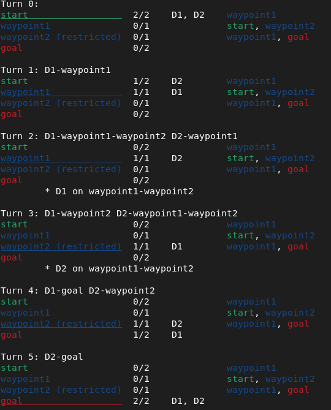

*This project has been created as part of the 42 curriculum by tanrandr*

# Fly-in

## Description

`Fly-in` is a rouing program that aims to **navigate efficiently a fleet of drones from a starting zone to an ending zone** across a network of connected zones. The system aims for all the drones to reach the designated goal in **as few simulation turns as possible**, while complying to **a set of movement constraints**.

### The network

The network, or `Graph`, as refered to across the source files, is made up of Zones and Connections linking said zones to each other, ensuring that there's a viable route for the fleet to reach the goal.

Zones and connections in-betweens are defined based on a set of characteristics :
- **Capacities** : each zone and connection has a maximum number of drones that can occupy said zone or capacity simultaneously. If not specified, the capacity efaults to 1 drone.
- **Type**: some zones are slower to enter, if they are restricted ; other zones might be blocked entirely, while some others are considered priorities in the pathfinding process. The type of the zone also influences its entry cost. A normal zone and a priority zone will cost 1 turn to a drone trying to access it, while a restricted zone requires 2 turns.
- **Colors**: zones can be defined with custom colors that will be displayed throughout the colored terminal output if said color finds a match in a predefined ANSI dictionary. Otherwise, the color will simply default to the terminal's.

### How it works
To put it simply, the program reads and parses a map file fed to it through the shell command line, plans a route for every drone in the fleet, checks the drafted plan against the set of movement constraints with an independent simulation, and then prints the movements turn by turn. An optional colored display shoes the state progression of every zone after each turn throughout the simulation.

### The map file content
The map file, aka the actual base of the network navigation for the fleet of drones, is one of the main foundations of this program's operation. The file is bonded by a set of strict rules regarding the format of its content, that make or break the file :
- The first line of the file must be **nb_drones: number** with a number greater than 0.
- A Zone declaration must look like : **hub: name x y [metadata]**. Metadatas are optional and the brackets should only be included if actual metadatas exist. This block, if it exists, must be the last element of its line and appear at most once.
- Zone metadatas might include, at most one time :
  - the Zone type, as **[zone=restricted/normal/priority]**. It defaults to normal if not specified.
  - the color : **[color=blue]**. Any one string word will be admitted.
  - the capacity : **[max_drones=2]**.
  - anything else will be unrecognized and trigger an error.
- A Connection declaration must be formatted as followed : **connection: name1-name2 [metadata]**.
- Connection metadatas might include :
  - the capacity, as **[max_link_capacity=3]**
- Given the name format of a connection linking two zones, a Zone's name shall not include a dash (-) in it.

Hereby an example of a valid map file :

```txt
# Easy Level 2: Simple fork with two paths
nb_drones: 4

start_hub: start 0 0 [color=green]
hub: junction 1 0 [color=yellow max_drones=2]
hub: path_a 2 1 [color=blue]
hub: path_b 2 -1 [color=blue]
end_hub: goal 3 0 [color=red]

connection: start-junction [max_link_capacity=2]
connection: junction-path_a
connection: junction-path_b
connection: path_a-goal
connection: path_b-goal
```

## Instructions

**Requirements** :
- Python 3.10 or later;
- `pip` as the package manager. The requirements.txt file locate at the root of the project repository lists a few dependencies to be installed to ensure the `make` targets work properly.

Install dependencies and create a .venv:
```bash
make install
```

Run the program on a map file:
```bash
make run ARGS="maps/easy/01_linear_path.txt"
```

To toggle the colored terminal output option, add `--visual` to the arguments:
```bash
make run ARGS="maps/easy/01_linear_path.txt --visual"
```

Other useful `make` targets include:
- `make debug` : run under `pdb` (`python -m pdb main.py <mapfile_path>`)
- `make lint` / `make lint-strict` : `flake8` + `mypy` (`flake8-docstrings` checks PEP 257 compliance against the numpy model)
- `make clean` : remove `__pycache__`, `.mypy_cache`, and the virtualenv

Alternatively, it is also possible to run the program against a map file without make:

```bash
python3 main.py maps/easy/01_linear_path.txt [--visual]
```

For the sake of organization and separation, the required ouptut (the turn lines) are printed on standard output while the visual display are sent to standard error. This design choice was made so that running the following command :
```bash
python3 main.py maps/easy/01_linear_path.txt --visual > result.txt
```
would only save the turn lines (the required output) to the pointed file while keeping the colored display on the terminal.

## Movement rules

The drones routing performed by this program has been designed meticulously based on a set of movement rules that tie the path finding algorithm together and allow the drones to move across the network without breaking the capacity of the zones and connections. The applied rules are as followed:
- A drone frees its place on the same turn it's leaving a zone.
- Zone capacity is checked on the drone positions after the turn.
- The start and end zone have no capacity. Their capacity defaults to the number of drones in play for clarity.
- When a drone use a connection, it counts agains the capacity of that connection during that turn, regardless of its direction, means two drones crossing a link on a given turn count as 2.
- Entering a restricted zone takes 2 turns: the drone is on the connection during the first turn (counting against the connection's capacity on that turn) and must reach the other zone on the second turn. This means the drone may only depart from one end of the connection if the other end (the destination) is ensured to have enough place on the second turn.
- A drone in transit (on a connction during one turn, on its way to a restricted zone) is printed with the connection name in map file order, not in the direction order.

## Algorithm

### General overview

The problem tackled by the program canbe separated in two distinctive parts: finding cheap route, and scheduling several drones so that they can efficiently share zones and connections without exceeding the allowed capacity. The program plans the drones one at a time, each around the space and time already reserved by the previous drones, and then verifies the whole plan (the moves per turn) with a separate simulation.

The program was designed to run in 4 separate yet interdependent stages:

### Parsing stage
This entering step is performed by the `MapParser` class in the **parsing.py** source file. It validates the map file to run line by line and reports the line and the error in case there's any.

### Reachability stage
The second step, performed by the `PathFinder` class in the **graph.py** source file, uses `Dijkstra's alorithm` to find the cheapest route for a single drone on the map.
Each move costs the entry cost of the destination zone (1 or 2 for restricted zones). The algorithm also ensures that blocked zones are never entered. For routes with the same number of turns, the one through the priority zones wins. So instead of merely comparing the cost of routes, the algorithm uses a `(turn, priority_zones)` cost tuple, where 'priority_zones' is either 0 or -1.

    Python compares tuples element by element, so the number of turns (the first element of the tuple), always decides first whether a route is cheaper than another. The number for the priority zone (second element) only serve as a tie breaker if two routes have the same number of turns.

This step runs one time before any planning and ignores every other drones. It tries to secure an optimal route for one drone to decide if the program can move forward. If no route is found, it triggers an error and ends the program early stage. Otherwise, the resulting route's length will be used to set a number of turn limit for the planner.

### Planning stage
The third step is performed by the `Planner` and the `ReservationTable` classs located in the **planner.py** source file.

The `ReservationTable` records how many drones are planned in each zone at each time of the simulation, and in each connection during each turn.

Drones are planned **one at a time**, in order. For each drone, the `Planner` searches for its shortest arrival around the earlier bookings in the `ReservationTable`. The search is the same Dijsktra loop as in `PathFinder`, but slightly different. The loop was tweaked to be **time aware** by replacing the state, previously a zone, by a pair of **(time, zone)**

    In practice, being in a zone at time 1 and in the same zone at time 2 are two different states, because the reservation differs.

From a given state (t, zone), the drone has three options based on the reservation at time t:
- it can wait in the current, the next state would then become **(t + 1, zone)** IF zone has room at time t + 1.
- it can move to a normal or priority neighboring zone, the next state would then be **(t + 1, neigbor)**, IF the neighbor has enough space at t + 1 and the connection between **zone-neighbor** has room during turn t + 1.
- it can engage on the way to a restricted zone, the next state would then become **(t + 2, restricted_neighbor)**, IF the connection **zone-restricted_neighbor** has room during t + 1 and the restricted zone has room at t + 2.

Once the earliest route for a drone is found, every step of the route is booked in the table (reserve zone and connections at specific times) and the drone's moves are written into the plan, **one drone id to connection dictionary per turn**.
The next drone will plan around those bookings.

Path distribution and waiting are handled as follow during the search: when the fastest route is fully booked at the required times, a later drone finds that waiting, or taking another branch, arrives earlier, and will choose accordingly.

### Simulation stage
This operation is performed by the `Simulation` class located in the **simulation.py** source file. It has been designed to replay the plan (the moves per turn) generated by the planner turn by turn, checks every rule and produces the expected output lines.

For each turn, the `Simulation`:
  - checks every move in the 'drone id to connection dictionary': makes sure the drone exists, that it's not delivered yet or in transit during said turn, and is at one end of the specified connection.
  - checks the zone capacities after the turn is over (the moves would've been applied at that point).
  - checks the connection capacities during each turn.

If all the checks pass, the planned moves are applied and the Simulation produces the output line. This means a turn is either applied completely or not at all.
Ths Simulation is separated from the Planner and implements all the checks separately, so an incorrect plan is rejected with an error instead of producing a false solution.

## Visual representation

Due to time management issues, `colored terminal output` was choosen between the two possible options suggested by the initial subject on this matter, as opposed to a `graphical interface`.

    The turn lines are colored by the destination zone's color when standard error is a terminal.

For precision, the zone's color can be any valid single-word string. There is no fixed list of "allowed" colors, which would imply that any other colors outside said list would not be allowed and, thus, crash the program. However, because there's no way for the program to display the colors on the terminal if not told their ANSI escape codes, a list was build for this purpose only. **It is not an allowed colors list**, means every other colors outside the list would still pass, but since the program was not provided the ANSI escape code for that color, it will display the zone in the default terminal color (namely white).

    The --visual flag tells the program to display the colored terminal output.
        example : make run ARGS="maps/easy/01_linear_path.txt --visual"

The output is displayed as followed :


- Each section represents the states of each zone at every turn.

- Each row shows the zone's name in its map color (if available), its occupancy against its maximum capacity, the drones occupying it, and its linked neighbors.

- Full zones are underlined, priority zones are written in bold, and restricted zones are labeled as such. Blocked zones are marked.

- Drones in transit are listed below the zones with the connection they are currently on.

    Following the occupancy turn by turn shows where the drones queue and why a drone waits or takes a longer branch to reach the goal.

- Colors (the ANSI escape codes) are automatically disabled when standard error is not a terminal, which means redirected output contains no escape codes.

- As mentionned prior, unknown color names are shown without color rather than causing an error.

## Complete example

Let's consider as input the example map from the subject :

```txt
nb_drones: 5

start_hub: hub 0 0 [color=green]
end_hub: goal 10 10 [color=yellow]
hub: roof1 3 4 [zone=restricted color=red]
hub: roof2 6 2 [zone=normal color=blue]
hub: corridorA 4 3 [zone=priority color=green max_drones=2]
hub: tunnelB 7 4 [zone=normal color=red]
hub: obstacleX 5 5 [zone=blocked color=gray]

connection: hub-roof1
connection: hub-corridorA
connection: roof1-roof2
connection: roof2-goal
connection: corridorA-tunnelB [max_link_capacity=2]
connection: tunnelB-goal
```

The required output of the command `python3 main.py map.txt` would be :

```code
D1-corridorA D3-hub-roof1
D1-tunnelB D2-corridorA D3-roof1 D5-hub-roof1
D1-goal D2-tunnelB D3-roof2 D4-corridorA D5-roof1
D2-goal D3-goal D4-tunnelB D5-roof2
D4-goal D5-goal
```

By adding the `--visual` flag, it would also output the colored lines :




## Performance

The program was designed based on a set of map files provided at the start of the subject. For each map file complexity, an expected performance target was defined to mesure the optimization level of the implementation and its efficiency.

|Map file|Drones|Target (<=)|Performance achieved|
|:---:|:---:|:---:|:---:|
|||**Easy maps**|
|Linear path|2|6|5|
|Simple fork|4|8|4|
|Basic capacity|4|6|4|
|||**Medium maps**|
|Dead end trap|5|12|8|
|Circular loop|6|15|10|
|Priority puzzle|5|12|6|
|||**Hard maps**|
|Maze nightmare|8|30|13|
|Capacity hell|12|35|16|
|Ultimate challenge|15|45|26|
|||**Challenger map**|
|The impossible dream|25|45|43|

## Resources
- Further learning about dataclasses in Python:
    - https://docs.python.org/3/library/dataclasses.html
    - https://medium.com/@laurentkubaski/python-data-classes-f98f8368f5c2
- Understanding Djikstra's shortest path algorithm:
    - https://www.codecademy.com/article/dijkstras-shortest-path-algorithm
    - https://www.w3schools.com/dsa/dsa_algo_graphs_dijkstra.php
    - https://www.geeksforgeeks.org/dsa/dijkstras-shortest-path-algorithm-greedy-algo-7/
    - https://www.geeksforgeeks.org/dsa/time-and-space-complexity-of-dijkstras-algorithm/
- ANSI escape code guide for colored terminal display:
    - https://jakob-bagterp.github.io/colorist-for-python/ansi-escape-codes/extended-256-colors/#structure

